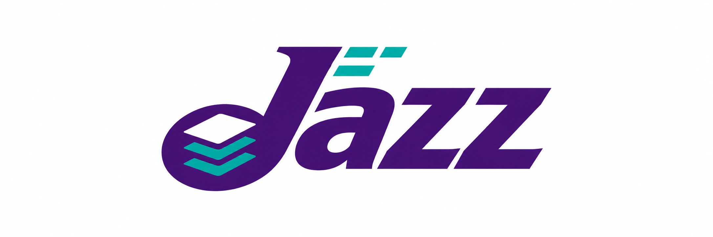

<p align="center">
  
</p>

Jazz is an experimental data-transfer engine written in C17 for AI inference
and training workloads. The initial focus is inference data movement, including
KV-cache migration and weight distribution.

The core works with opaque memory ranges. Model-specific KV layouts and
framework lifecycles belong in adapters. The architecture is intended to grow
across host/GPU memory, local and network transports, and topology-aware paths.

The current Linux implementation focuses on the RDMA/RoCEv2 backend:

- Engine lifecycle, device capabilities, HOST memory registration across devices,
  concurrent batches, bounded registration helpers, and retryable cleanup.
- Real RDMA_CM and TCP OOB binding and RC connection setup, background control,
  bounded passive admission, handshake deadlines, and safe shutdown.
- RXE two-process integration tests with private RDMA READ/WRITE/SEND probes.

Public payload submission, remote memory descriptors, and the transfer
WorkerPool are still under development. GPU memory/GPUDirect RDMA, TCP payload,
shared memory, GPU peer-copy/staging paths, and a vLLM JazzConnector are planned
extensions. Each explicit connection currently uses one RC QP; connection-cache
coalescing is future work.

Numeric local IPs must match a typed RoCEv2 GID on the selected device.
Cleanup-pending buffers must stay allocated until cleanup succeeds.

Build with CMake and the libibverbs/librdmacm development packages:

```sh
cmake -S . -B build -DCMAKE_BUILD_TYPE=Debug
cmake --build build --parallel
ctest --test-dir build --output-on-failure
```

Public headers are under `include/jz`; link against `libjz`.
Code comments are in English. The API is not stable.

For VS Code on macOS, open this repository folder and run **Dev Containers:
Reopen in Container**. The included configuration builds Linux dependencies and
supplies IntelliSense with CMake's compilation database. Use **Build Jazz** or
**Test Jazz** from Run Task.

Set `JZ_TEST_IP` and optionally `JZ_TEST_DEVICE` (default `rxe0`) to run device
tests; otherwise they report SKIP. Device tests require an RNIC or an RXE-enabled
Linux kernel. Docker alone does not provide RDMA, and Soft-RoCE tests do not
establish hardware performance.

`jz_reg_bench DEVICE cm|oob BYTES ITERATIONS serial|auto|parallel [warm]`
reports registration/unregistration pair latency and process CPU time on
already-touched HOST memory. `cm|oob` selects context ownership; no peer
connection or payload transfer is timed.
